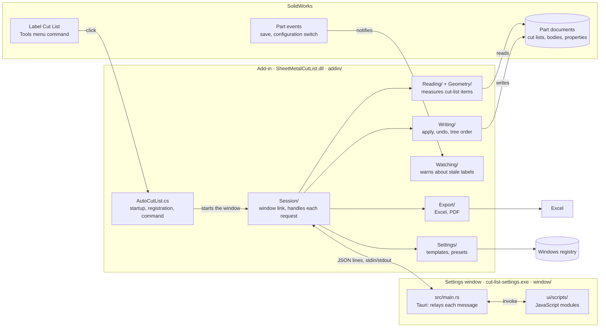

# Architecture

Auto Cut List is two programs. The SolidWorks add-in (`addin/`, built as `SheetMetalCutList.dll`) reads and labels parts. The settings window (`window/`, built as `cut-list-settings.exe`) is the user interface. The add-in starts the window, and the two exchange one line of JSON per message over the window's standard input and output.

## How a request flows

1. **Label Cut List** runs `LabelCutList` in `AutoCutList.cs`, which reads the active part and calls `StartSession`.
2. `StartSession` (`Session/WindowSession.cs`) launches `cut-list-settings.exe` and sends it the part, its settings and its cut list as one line of JSON.
3. The window (`window/ui/scripts/host.js`) sends requests such as Apply, Refresh or Export back through `src/main.rs`, one line each.
4. A background thread in the add-in reads each line and queues it onto SolidWorks' main thread. Requests run strictly one at a time, so a dialog or an Excel export can't let the next request start in the middle.
5. `Handle` and `PartRequest` (`Session/Requests.cs`) do the work with `Reading/`, `Writing/`, `Export/` and `Settings/`, then reply with the same request number.

## The add-in: `addin/`

`AddIn` is one `partial` class split across these files. Each folder groups one job.

| Folder | Files | What it does |
|---|---|---|
| (top) | `AutoCutList.cs` | COM registration, connecting to SolidWorks, the Label Cut List command, `Label` (one cut-list item) |
| `Session/` | `WindowSession.cs`, `Requests.cs`, `PartList.cs`, `Configurations.cs` | Starts the window, queues and answers its requests, keeps its part list current, switches configurations and back |
| `Reading/` | `CutListReader.cs`, `ExactSizes.cs`, `BodyShapes.cs`, `Profiles.cs`, `Lengths.cs`, `Properties.cs`, `Units.cs`, `PreviewMesh.cs` | Walks the cut list and measures each item: exact sheet-metal sizes, weldment profiles, round bars, lengths, unit conversion, the 3D preview mesh |
| `Geometry/` | `BoundingBox.cs`, `VectorMath.cs` | Fits the smallest box around a solid body; plain vector math |
| `Writing/` | `ApplyLabels.cs`, `Undo.cs`, `TreeOrder.cs` | Writes labels to cut-list properties (one part or a batch), undoes the last apply, reorders the FeatureManager tree |
| `Watching/` | `StaleLabels.cs` | Hooks part save and configuration events, and warns when a labeled item's fingerprint has changed |
| `Export/` | `ExcelExport.cs` | Writes the cut list and stock totals to an Excel workbook or a PDF |
| `Settings/` | `LabelSettings.cs`, `PresetStore.cs` | Label templates, window options and presets, kept in `HKCU\Software\SheetMetalCutList` |
| `Contracts/` | `IpcRequest.cs`, `FieldLocks.cs`, `MeshData.cs`, `ProfileInfo.cs`, `StockTotal.cs` | Data classes: the window's request format and small records |
| `Process/` | `WindowInterop.cs` | Win32 calls that bring the window forward and parent dialogs to it |

## The settings window: `window/`

| File | What it does |
|---|---|
| `src/main.rs` | The Tauri program: relays JSON lines between the add-in (stdin/stdout) and the page (`invoke`) |
| `ui/index.html`, `ui/style.css` | The page and its styles |
| `ui/scripts/main.js` | Entry point: loads the modules below |
| `ui/scripts/state.js` | Page elements, shared window state (`shared`), shared label settings, gauge tables. Imports nothing, so it runs first |
| `ui/scripts/labels.js` | Renders label templates into text |
| `ui/scripts/table.js` | The item table, category filter and details pane |
| `ui/scripts/templates.js` | The templates bar and `refresh()` |
| `ui/scripts/weldment-shapes.js` | Weldment shape families, profile libraries, shape settings and filter |
| `ui/scripts/symbols.js` | The Insert symbol buttons |
| `ui/scripts/preview.js` | The WebGL 3D body preview |
| `ui/scripts/host.js` | Talking to the add-in: requests, replies and startup |
| `ui/scripts/presets.js` | Template presets and configuration switching |
| `ui/scripts/parts.js` | All open parts (batch apply) and the part selector |
| `ui/scripts/settings-events.js` | Event hookups for the Settings panel and shared settings, loaded last |
