# Auto Cut List user guide

Auto Cut List is a SolidWorks add-in that fills in the **Description** and **Length** properties of every cut-list item in a part, using templates you control. It sorts each item into **Sheet Metal**, **Weldment** or **Regular Part**, measures it, and builds its labels from that category's templates. You review every change before anything is written to the part.

## Contents

1. [Getting started](#getting-started)
2. [The window](#the-window)
3. [Templates](#templates)
4. [Labeling a part](#labeling-a-part)
5. [Several parts and configurations](#several-parts-and-configurations)
6. [Weldment shapes](#weldment-shapes)
7. [Reordering and exporting](#reordering-and-exporting)
8. [Settings](#settings)
9. [How items are measured](#how-items-are-measured)
10. [Troubleshooting](#troubleshooting)

## Getting started

### Requirements

- 64-bit SolidWorks 2026
- Windows with the [Microsoft Edge WebView2 Runtime](https://developer.microsoft.com/microsoft-edge/webview2/) (already included in Windows 11)
- Microsoft Excel, only for **Export to Excel** and **Export to PDF**

The installer uses the SolidWorks API libraries from your own SolidWorks installation.

### Install

1. Download **AutoCutList-setup-<version>.exe** from the [latest release](https://github.com/3Djuche/Auto-Cut-List/releases/latest).
2. Save your work and close SolidWorks, then run the setup program and approve the administrator prompt. The files aren't code-signed, so Windows SmartScreen may warn about an unrecognized app; choose **More info > Run anyway**.
3. Leave **Load Auto Cut List every time SolidWorks starts** checked (or check **Auto Cut List** under **Tools > Add-Ins** later).
4. Open SolidWorks and choose **Tools > Auto Cut List > Label Cut List**.

The add-in is installed to `C:\Program Files\Auto Cut List for SolidWorks`. Installing needs administrator rights; where users don't have them, IT can install it silently with `AutoCutList-setup-<version>.exe /VERYSILENT`. To upgrade, run the new version's setup program; your templates and presets are kept. An earlier version installed with Install.cmd, or under the add-in's old name, Sheet Metal Cut List, is replaced.

To uninstall, close SolidWorks and remove **Auto Cut List** under Windows **Settings > Apps > Installed apps**. Your templates and presets stay in your Windows profile, ready for a reinstall.

### Open the window

Choose **Tools > Auto Cut List > Label Cut List**.

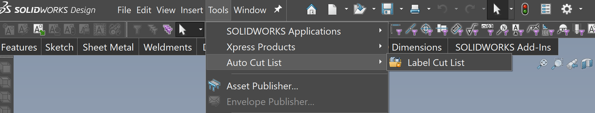

If a part is active, its cut list loads. Otherwise the window opens empty: open a part in SolidWorks, then click **Refresh** (next to the Part list) to load it.

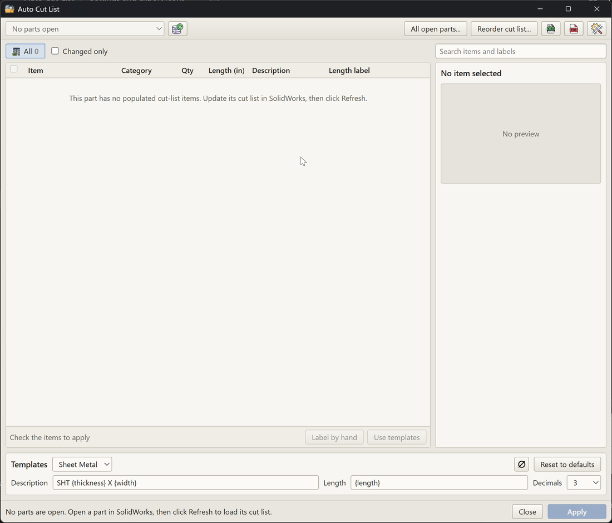

### Label your first part

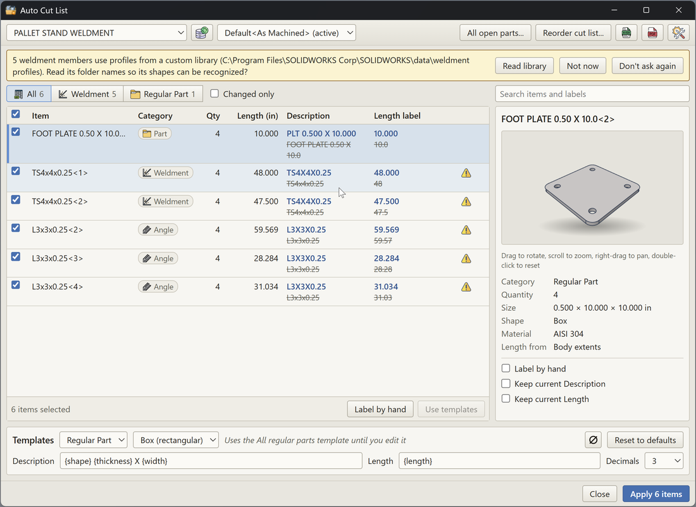

1. Open the window with the part loaded, as above.
2. The table lists every cut-list item with its category, quantity, measured length, and the **Description** and **Length** labels the templates produce. Labels that would change are shown in blue, with the current value struck through underneath.
3. Edit a category's templates in the **Templates** bar at the bottom. Clicking an item switches the bar to that item's category, and the table updates as you type.
4. Check the items you want to write (the checkbox in the header selects every changed item shown) and click **Apply**.
5. Save the part to keep the labels.

Nothing is written to the part until you apply, and **Close** discards any unapplied edits.

The window stays open after each action (apply, reorder, export), and the result appears at the bottom of the window. After an apply or reorder, the list refreshes from the part; unapplied Custom edits and locks on other items are kept. SolidWorks stays usable while the window is open, so you can rotate or inspect the model alongside it.

The command works with any document active, or none. Only one window is open at a time.

## The window

- **Toolbar:** the Part list and **Refresh**, then **All open parts**, **Reorder cut list**, **Export to Excel**, **Export to PDF** and **Settings** (the last three are icon buttons; hover for their names).
- **Filters:** show All items or one category (Sheet Metal, Weldment, Regular Part, Custom), with a count for each. **Changed only** hides items that applying wouldn't change, and the search box matches item names and labels.
- **Table:** click a row to select it. A ⚠ marks a weldment whose Length is linked to SolidWorks' cut length, a ↻ marks an item whose model changed since it was labeled, and a 🔒 marks a field that's being kept.
- **Details pane:** the selected item's 3D preview, category, quantity, size, shape, gauge and length basis, plus **Label by hand**, **Keep current Description** and **Keep current Length**. When the window is narrow, the pane moves under the table.
- **Templates bar:** the Description and Length templates and decimal places for one category, chosen with its dropdown. **Insert symbol** shows the symbol buttons, and **Reset to defaults** restores the category's original templates. For an item labeled by hand, the bar edits that item's own labels instead.
- **Status bar:** results and errors, **Undo last apply** (after an apply), **Close**, and **Apply**.

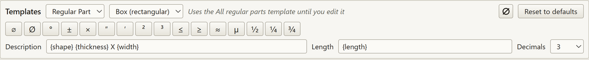

**Part:** the dropdown at the top lists the parts open in their own SolidWorks windows (parts loaded only as assembly components aren't listed). Choose a part to load its cut list; if you have unapplied Custom edits or lock changes, you're asked before they're discarded. Every action works on the part shown in the dropdown, whichever document is active in SolidWorks. The list updates on its own when parts are opened, closed or saved under a new name. **Refresh**, next to the dropdown, reloads the selected part's cut list from SolidWorks. If you run the command on another part while the window is open, the window comes to the front and offers to switch to it. If the window has no part (it was opened without one, or its part was closed), Refresh loads the part that's active in SolidWorks, or else the first open part; you can also choose one from the list.

If the cut list or its labels change in SolidWorks while the window is open, the next apply or reorder refreshes the list instead of writing anything, so you can check your changes first. Unapplied Custom edits and locks are kept when the same part is refreshed.

## Templates

A template is ordinary text with fields in braces. For example:

- Description: `STOCK {type} {thickness} X {width} SS`
- Length: `CUT {length} LONG / QTY {quantity}`

| Field | Inserts |
| --- | --- |
| `{type}` | `Sheet`, `Weldment` or `Solid` |
| `{thickness}` | Smallest dimension (sheet thickness), or the gauge if **Use gauge** is on and the item has one |
| `{width}` | Middle dimension |
| `{length}` | Largest dimension, or the weldment cut length |
| `{quantity}` | Number of bodies in the cut-list item |
| `{gauge}` | The gauge assigned in SolidWorks, such as `14 GA`, or with **Use gauge** on, the standard gauge matching the thickness (blank if none) |
| `{default}` | Weldment only: the item's original callout |
| `{shape}` | Regular Part only: `Box`, `Cylinder` or `Mixed` |
| `{material}` | The item's material in SolidWorks (blank if none is assigned) |
| `{angle1}`, `{angle2}` | Weldment only: the end-cut angles in degrees, such as `45` or `22.5`; add `°` yourself if you want it |
| `{profile}`, `{size}`, `{side1}`, `{wall}` ... | Weldment only: the member's shape and size fields; see [Weldment shapes](#weldment-shapes) |

Each category has its own templates and **Decimal places** (0–8), which control `{thickness}`, `{width}` and `{length}`. Inches and millimeters each keep their own decimal places (3 and 1 by default), so switching units switches to that unit's setting.

The add-in reads sizes without changing the part, so opening the window or refreshing never makes SolidWorks ask you to save. Sheet thickness and flat-pattern sizes are read exactly from the sheet-metal feature and the flat pattern's bounding-box sketch. If one can't be read that way, the add-in uses SolidWorks' cut-list value, which is rounded to the part's decimal places for length. A label that needs more decimal places than that shows a template error instead of a wrongly rounded size; use fewer decimal places, or raise the part's in SolidWorks (Document Properties > Units).

These options apply to every category:

- **Capitalization:** ALL CAPS, no caps, or First Letter Of Every Word. Title case capitalizes the first letter of each word. With **Leave words typed in capitals as they are** on (the default), a word that's entirely capitals, such as `GA`, `TS` or `SS`, is kept, so `14 GA` stays `14 GA`; turn it off to get `14 Ga` and `Stock` from `STOCK`. Only letters change case; symbols such as ⌀, Ø, °, ± and µ are always kept exactly as typed.

- **Numbers less than one:** with a leading zero (`0.500`) or without (`.500`).
- **Inch values:** decimals (`1.250`, the default) or fractions (`1-1/4`), rounded to the nearest 1/2 through 1/64 (1/16 by default). Fractions apply to measured sizes and weldment profile sizes, and only with imperial units.
- **Units:** Imperial (inches) or Metric (millimeters) for `{thickness}`, `{width}` and `{length}`, whatever units the part uses. Labels don't add a unit symbol, so type one in the template if you want it (for example `{length} MM`).
- **Use gauge** (Sheet Metal and Regular Parts) puts a gauge in `{thickness}`: the gauge assigned in SolidWorks if there is one, or else the standard gauge whose thickness matches the item's, so a 0.1196 in steel part is labeled `11 GA`. The table depends on the item's material:
  - Steel, and items with no material: Manufacturers' Standard Gauge (3–38 GA).
  - Galvanized steel: the galvanized table (8–32 GA).
  - Stainless steel (names containing "stainless", or AISI 301–440): the stainless table, from 7 GA (3/16 in), or the steel table's decimals, which most suppliers sell stainless sheet at (11 GA = 0.120 in); thicker stainless is left as plate.
  - Aluminum (names containing "aluminum", or alloys such as 6061 and 5052): Brown & Sharpe gauge (6–30 GA).
  - Other materials (copper, brass, plastics and so on) get no gauge.

  A thickness matches a gauge within 0.0005 in. Items that match none keep their measured size, and the details pane shows which gauge was matched and from which table. Gauges are written as `14 GA`, even if your template adds its own `GA`. This does not change the model or its gauge table.

**Symbols:** templates and Custom labels can contain any Unicode character. Click in a Description or Length box (in the Templates bar or a hand-labeled row), click **Insert symbol** in the Templates bar, then click a symbol (⌀ Ø ° ± × ″ ′ ² ³ ≤ ≥ ≈ µ ½ ¼ ¾) to add one at the cursor, or paste any other symbol. Whether a symbol shows on a drawing depends on the font the drawing uses.

The full list of fields is also under **Settings > Field reference**:

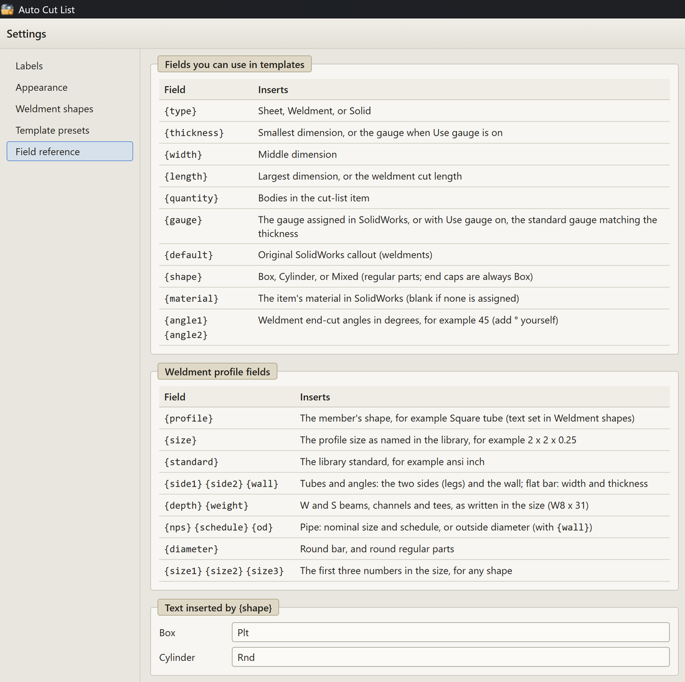

## Labeling a part

### Applying

There's no separate review step: the table shows each item's current and proposed labels side by side. Check the items to write and click **Apply**. Applying is all-or-nothing: if SolidWorks refuses any write, every property already changed is put back and you're told which item failed. After applying, the table reloads from the part; unapplied edits on other items are kept.

### Labeling items by hand

For items that need hand-written labels, select the item and check **Label by hand** in the details pane, or check several rows and click **Label by hand** under the table. The item's category becomes **Custom**, it starts with the labels its template currently produces, and you can type its Description and Length right in the table (or in the Templates bar while it's selected). Template fields such as `{length}` still work in these labels.

**Use templates** (or clearing **Label by hand**) puts items back on their category templates. The **Custom** filter lists every item labeled by hand.

### Protecting hand-edited labels

To stop a field from being overwritten, select the item and check **Keep current Description** or **Keep current Length** in the details pane. The table then shows the current value in gray with a 🔒. Locks are stored in the part when you apply that item, so save the part to keep them.

### Undo

After an apply, **Undo last apply** appears in the status bar. It puts back every property that apply changed, including labels, hand-label and keep settings, in each part it touched that's still open. It restores the values from before the apply, except for any Description or Length you changed in SolidWorks after the apply: those are kept, and the message lists them. Only the most recent apply can be undone, and only while the window stays open.

### Items that can't be measured

If the add-in can't measure an item (for example, a sheet-metal body with no flat-pattern size), it still appears in the table, marked **Can't measure** in red. Hover over it, or select it and look in the details pane, to see why.

Its automatic labels are turned off and it can't be checked for Apply; everything else labels normally. To label it anyway, select it and check **Label by hand**. It starts with the labels already stored in the part, and measurement fields like `{length}` aren't available for it.

Unmeasured items are still included in Reorder and in both exports.

### Out-of-date labels

Labels are fixed text, so they don't follow the model. When an item is labeled, the add-in records what it measured (size, quantity, profile, material, end angles and gauge) in the item's `CutListLabelerBasis` property. Later:

- In the window, a ↻ marks any item whose measurements have changed since it was labeled. Templated items also show their new label in blue; hand-labeled and kept items need a look.
- When you save a part, or switch it to another configuration, SolidWorks shows a warning if any labeled items in the active configuration have changed. SolidWorks can only measure the active configuration, so each configuration is checked when you switch to it. The warning appears once for a given set of items, not every time. Turn it off under **Settings > Labels**. The check first compares a quick fingerprint of each labeled item (its bodies' volume and surface area and the properties labels use) and only re-measures the cut list if one differs; items labeled by an earlier version have no fingerprint until their labels are applied again.

Items labeled with an earlier version have no recorded measurements, so they aren't checked until they're applied again.

## Several parts and configurations

### All open parts

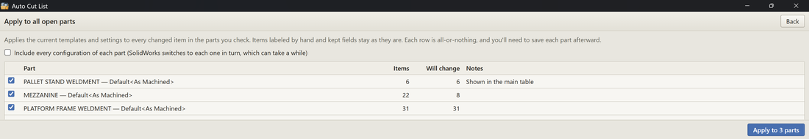

**All open parts** reads the cut list of every part open in its own window and lists them with how many labels would change. Check the parts you want and click **Apply to N parts**. It uses the current templates and settings. Items labeled by hand and kept fields stay as they are, and items that can't be measured are skipped. Each row is all-or-nothing, a part whose cut list changed in SolidWorks since it was read is skipped, and **Undo last apply** covers the whole batch. Save each part afterward.

### Configurations

Cut-list labels belong to a configuration. When a part has more than one, a configuration list appears next to Refresh: the table starts on the configuration active in SolidWorks (marked "(active)"), and choosing another shows its cut list. Refresh, Apply, Reorder, Export and Undo then work on the configuration shown; the add-in switches to it for each request and back again, so SolidWorks stays on the configuration you were working in (the model may flicker briefly, and on large parts each request takes longer). Because SolidWorks marks a part as changed whenever its configuration switches, the window asks before showing a configuration that isn't active. If SolidWorks ever refuses to switch a part back, the window says which part was left on which configuration. To label every configuration at once, use **All open parts** with **Include every configuration of each part** checked. SolidWorks switches to each configuration in turn to read it, which can take a while on large parts, and each configuration gets its own row. Every part is returned to the configuration it started on.

## Weldment shapes

Weldment members come in many shapes, so each shape can have its own templates instead of sharing one.

**How a member's shape is found.** The add-in reads the profile each structural member (or Structure System member) was built from. In a profile library, that's the folder and file, laid out as *standard / shape / size* (`ansi inch\square tube\2 x 2 x 0.25`), or one file per shape with each size as a configuration. It also looks at the member's SolidWorks callout and its cut-list name. SolidWorks' default profile names, and common designations such as `TS`, `HSS`, `W8x31`, `C3x4.1` and `L2x2x1/4`, are recognized automatically, giving these shapes:

| Shape | Its own fields |
| --- | --- |
| Square tube, Rectangular tube, Angle | `{side1}` `{side2}` `{wall}` |
| Round tube (round HSS, CHS) | `{od}` `{wall}` |
| Pipe | `{nps}` `{schedule}`, or `{od}` `{wall}` |
| W beam, S beam, C channel, Tee | `{depth}` `{weight}` |
| Flat bar | `{side1}` (width) `{wall}` (thickness) |
| Square bar | `{side1}` |
| Round bar | `{diameter}` |
| Other weldments | (none) |

Every shape also has `{profile}` (the shape's name, editable in Settings), `{size}` (the size as named in the library), `{standard}`, and `{size1}` `{size2}` `{size3}` (the first three numbers in the size). For example, Square tube might be `TS {side1} X {side2} X {wall}` and W beam `W{depth} X {weight}`.

Wall, side, leg, diameter and OD values follow your units, decimal places, leading-zero and fraction settings, with trailing zeros dropped (`2`, `0.25`, or `1/4` with fractions). Depth, weight, nominal pipe size and schedule are written exactly as in the size (`W8 X 31`). A metric library's sizes are converted when you use imperial units, and the other way round.

**Templates per shape.** In the Templates bar, choose **Weldment**, then a shape. A shape uses the **All weldments** template until you edit it; **Use All weldments template** removes its own. Clicking a weldment member switches the bar to its shape. When the Weldment filter is on, a second row of filters splits the list by shape, and the Category column shows each member's shape. Each shape has its own icon, shown on its filter, its Category tag and in Settings > Weldment shapes.

Round tube and Square bar were added as shapes of their own. Round HSS and tube profiles that were sorted under the old "Pipe / round tube" shape are now Round tube, so templates you gave that shape still apply to pipe but not to round tube; give Round tube its own templates if it needs them.

**Custom profile libraries.** When a part uses profiles from a library other than SolidWorks' default one, a bar at the top of the window asks whether to read it. **Read library** lists that library's folder and file names (nothing else) so its shapes can be matched; **Don't ask again** remembers your choice. In **Settings > Weldment shapes** you can:

- see every profile in the open part and the shape it was given, and change it;
- add **rules** ("a profile name containing `RT-` is a Rectangular tube"), which are checked before the built-in names;
- add your own shapes, such as Z purlin, and set the text `{profile}` inserts for each shape;
- review each library you've read, and assign any of its shapes that weren't recognized (highlighted).

Rules, custom shapes, `{profile}` text and shape templates are saved with your other settings (Save settings, Apply, or a preset), so changes you only try out aren't kept. Your answers to the custom-library prompt (Read library, Don't ask again, Forget) are kept straight away. Presets include shape templates, rules, custom shapes and `{profile}` text, so a preset works the same on another workstation; loading one replaces your current rules and custom shapes. Library choices stay with each computer.

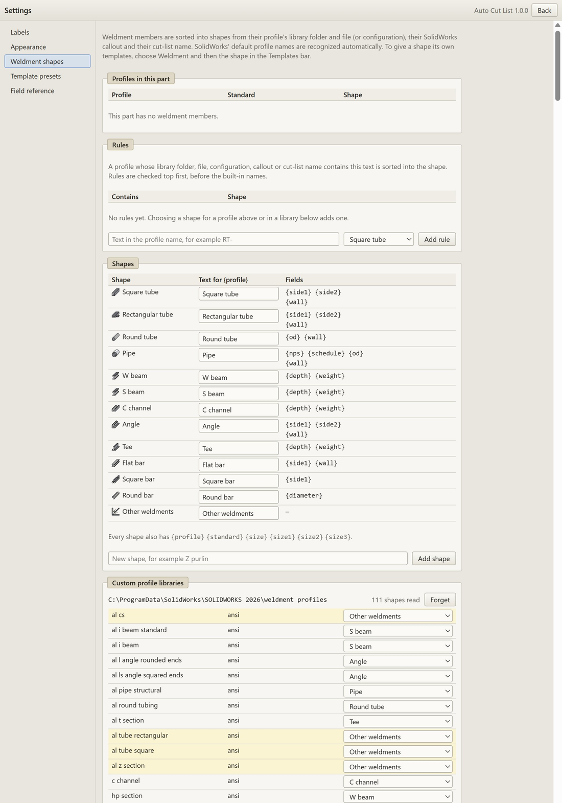

## Reordering and exporting

### Reorder the cut list

**Reorder cut list** previews the cut-list folders sorted by category, then Description, then numeric Length. Click **Apply tree order** to move them in the FeatureManager tree. The sort uses the labels already stored in the part, so apply your labels first. Save the part to keep the order.

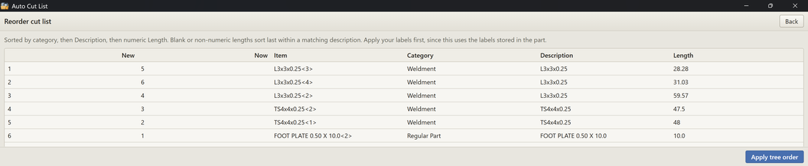

### Export to Excel or PDF

**Export to Excel** creates an `.xlsx` of the cut list with a thumbnail of each item. It exports the property values currently stored in the part, not unapplied edits. If the part has weldment members, a second sheet, **Stock totals**, adds up the pieces and total length for each profile (grouped by Description and material), in inches and feet or millimeters and meters to match your Units setting.

**Export to PDF** saves the same cut list and Stock totals as a PDF instead, printed landscape and one page wide with the column headings repeated on each page. Excel does the conversion, so it needs Excel too.

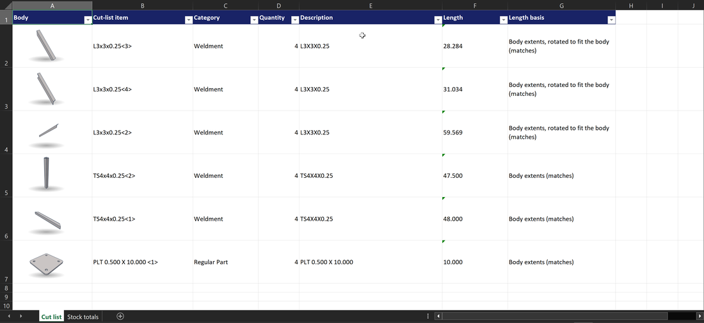

## Settings

Open **Settings** from the main window. Click **Back** to return to the cut list. The add-in's version is shown at the top.

- **Labels:** capitalization, units, leading zeros, inch decimals or fractions, the save warning for out-of-date labels, and Use gauge for sheet metal and regular parts. All apply to every category.
- **Weldment shapes:** profiles in the open part, shape rules, custom shapes and custom profile libraries (see [Weldment shapes](#weldment-shapes)).
- **Appearance:** the window theme (White, Off-white, Gray or Black), the window font, and the thumbnail style — Wireframe, Shaded or Shaded with edges, plus Shadows, Glossy lighting, Cartoon and Perspective. These affect only the preview and the Excel thumbnails. In the preview, drag to rotate, scroll to zoom, right-drag (or Shift-drag) to pan, and double-click to reset the view. With the preview selected, the arrow keys rotate, `+` and `-` zoom, and `0` resets.
- **Template presets:** named sets of templates (including weldment shape templates, shape rules and custom shapes), decimal places, capitalization, units, leading zeros, fractions, the gauge option and shape labels. They don't include parts, Custom items or locks. Presets are stored in the Windows registry with your other settings, for your Windows account.
  - **Save current settings as preset:** type a name and click it. Your current settings are saved too, and the preset becomes the active one. If the name is taken, you're asked before it's replaced.
  - **Load:** applies the selected preset straight away and saves it as your settings.
  - **Rename:** select a preset, type the new name in the Name box, and click Rename.
  - **Delete:** asks before removing the selected preset.
  - **Export to file / Import from file:** save a preset as a `.json` file, for example on a shared drive, and import it on another workstation.
  - The panel shows the **active preset**, and notes when your settings have changed since it was loaded or saved.
  - Presets made with an earlier version are moved into the registry automatically the first time the window opens.
- **Field reference:** the list of template fields, and the text `{shape}` inserts for a box or cylinder.

**Save settings** stores your templates and options without writing labels. Applying labels, and loading or storing a preset, saves them too. Nothing else does, so templates you're only trying out aren't kept when you refresh, export or close the window without saving. **Reset category defaults** restores the current category's original templates and decimal places; it doesn't change capitalization, units, leading zeros, the gauge option or appearance.

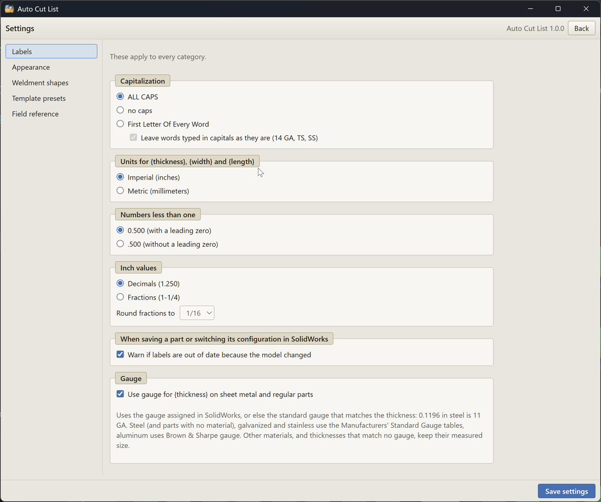

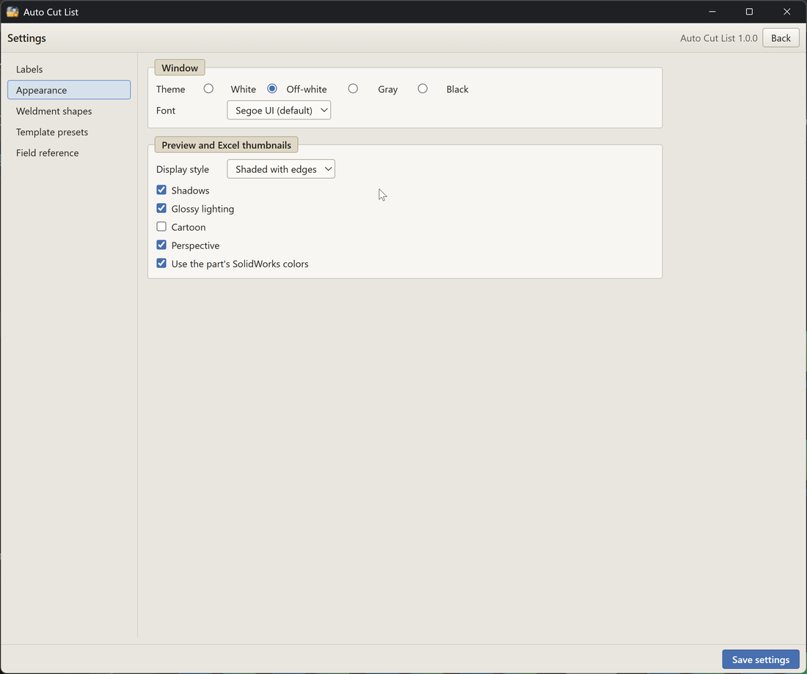

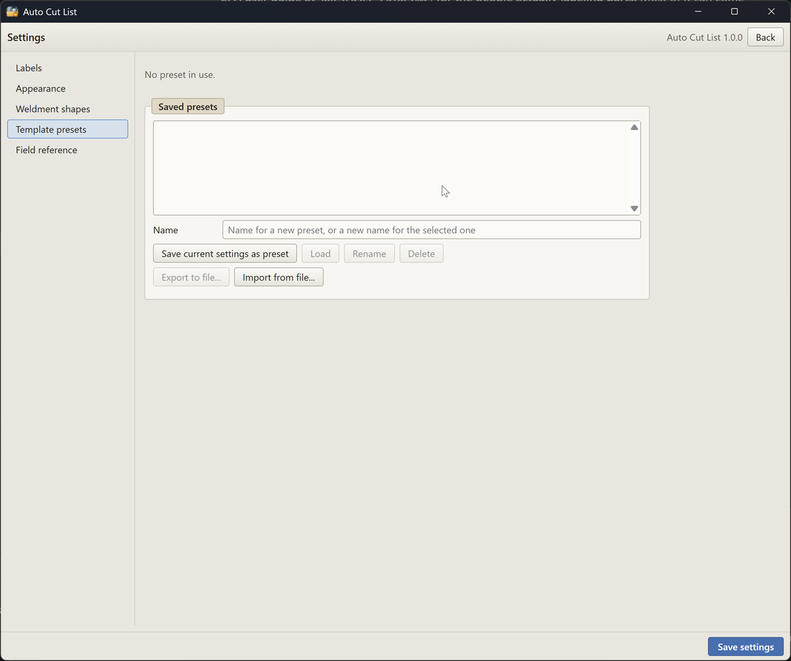

## How items are measured

| Category | Detected when | Dimensions come from |
| --- | --- | --- |
| Sheet Metal | Any body in the item is sheet metal | Sheet thickness and the flat-pattern bounding box |
| Weldment | Every body comes from a structural member or structure system — or the item has a SolidWorks linked Length or a recognizable tube or pipe callout | SolidWorks' cut length when available, otherwise body extents |
| Regular Part | Anything else, including weldment gussets and end caps | Body extents |

**Body extents** are the body's envelope, sorted smallest to largest as thickness, width and length. Bosses and other features that stick out are included. The envelope is measured along the part's X, Y and Z axes, unless the body is modeled at an angle: then the add-in tries orientations taken from the body's own flat faces and round axes and uses whichever gives the smallest envelope. The details pane shows "Body extents, rotated to fit the body" as the length basis when that happens. For an item with several bodies, the largest value of each dimension is used. Values are shown in inches or millimeters, following the **Units** setting.

Notes:

- The first time a weldment item is labeled, its existing callout is saved in the `CutListLabelerOriginalCallout` property, so `{default}` keeps working afterward. If there is no useful existing description, the structural-member profile name or the cut-list folder name is used.
- Applying a label replaces a linked `Length` property with plain text, so it will not update if the member changes. The table marks these items with ⚠, and the details pane explains it; check **Keep current Length** to keep the link, or reapply labels after editing the model.
- `{shape}` describes the stock envelope a Regular Part fits in. Every body is a `Box` unless its envelope is round: a `Cylinder` has a cylindrical face, aligned with a part axis, whose diameter matches the body's size across that axis (a round bar, tube or stepped shaft). Holes, pockets, rounded corners and bosses don't change a Box, and bosses are included in its dimensions. An item whose bodies differ is `Mixed`. You can change the text `{shape}` inserts for a box or cylinder under **Settings > Field reference**; leave one empty to insert nothing.

  A Cylinder is measured across and along its own axis: `{diameter}` is its diameter and `{length}` its length along the axis, even when it's shorter than it is wide. Regular parts have their own Box and Cylinder templates (pick one beside the category in the Templates bar); the Cylinder template starts as `{shape} {diameter} DIA` with `{length}` as Length, which labels a 1 in round bar `RND 1.000 DIA`. Bodies made by a weldment End Cap feature are always plates (thickness by width by length), even round ones.

## Troubleshooting

- **The settings window does not open.** The add-in shows the reason. If it mentions WebView2, install the Evergreen Runtime from the link under [Requirements](#requirements). If the window is missing, run the setup program again.
- **"No populated cut-list entries."** Update the cut list in SolidWorks and try again.
- **The window opens empty.** No part was active when you opened it. Open a part in SolidWorks and click **Refresh**, or choose one from the Part list.
- **Labels show a template error instead of a size.** The label needs more decimal places than SolidWorks stores for that size. Use fewer decimal places, or raise the part's in SolidWorks (Document Properties > Units).
- **Auto Cut List isn't in the Tools menu.** Check **Auto Cut List** under **Tools > Add-Ins** (and **Start Up** to load it every time).
